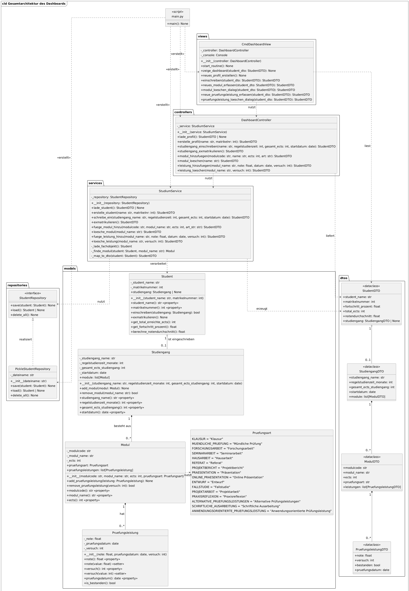
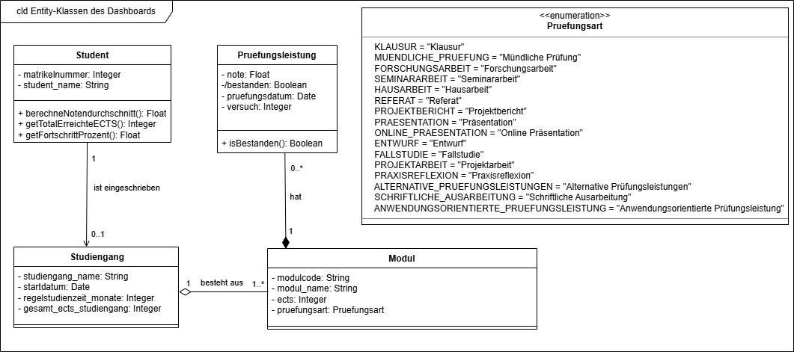

# Studien-Dashboard (Python, Konsole)

Konsolenanwendung, die den Fortschritt eines Studiums überwacht: Wie viele ECTS sind erreicht,
liege ich im Zeitplan, und erreiche ich meinen Wunsch-Notenschnitt? Im Mittelpunkt steht eine
saubere **objektorientierte Schichtenarchitektur** in Python.

## Funktionen

- Profil anlegen und in einen Studiengang einschreiben (Regelstudienzeit, ECTS, Startdatum)
- Module mit ECTS und Prüfungsart erfassen und löschen
- Prüfungsleistungen (Note, Datum, Versuch) erfassen und löschen
- Validierung nach Prüfungsordnung: Noten 1.0–5.0, maximal 3 Versuche, bestanden ab 4.0
- Dashboard mit zwei Zielen:
  1. **Studienfortschritt und Zeitplan:** ECTS, Fortschrittsbalken und Abweichung in Monaten
     (im Rückstand, auf Kurs, voraus) im Vergleich zur Regelstudienzeit
  2. **Notendurchschnitt:** Vergleich mit dem Ziel ≤ 2.0

## Architektur



*Gesamtarchitektur: Schichten views → controllers → services → repositories/models, Datenaustausch über DTOs.*

| Schicht | Aufgabe |
|---|---|
| `views` | Ein-/Ausgabe in der Konsole (mit `rich`) |
| `controllers` | nimmt Aktionen der View entgegen und delegiert an den Service |
| `services` | Geschäftslogik; liefert nur read-only **DTOs** an die View |
| `repositories` | Speichern und Laden (hinter einer abstrakten Schnittstelle, austauschbar) |
| `models` | Fachobjekte mit Validierung (Kapselung über Properties, Enum für Prüfungsarten) |

Die View kennt die Fachobjekte nicht, sondern nur DTOs. Dadurch lässt sich die Konsole später
durch eine Web-Oberfläche ersetzen, ohne die Logik anzufassen.

**Fachmodell (Entity-Klassen):**



## Installation

Voraussetzungen: Python 3.10 oder neuer (getestet mit 3.14), Windows 11.

```bash
git clone https://github.com/smilenow789/study-dashboard-python.git
cd study-dashboard-python
pip install -r requirements.txt
python main.py
```

## Hinweise

- Alle Daten werden lokal in `cmd_dashboard_daten.pickle` gespeichert und beim Start automatisch
  geladen. Falls noch kein Profil existiert, startet die Profilerstellung.
- Die Pickle-Datei nur aus eigener Quelle verwenden: Pickle ist für fremde Dateien nicht sicher.
